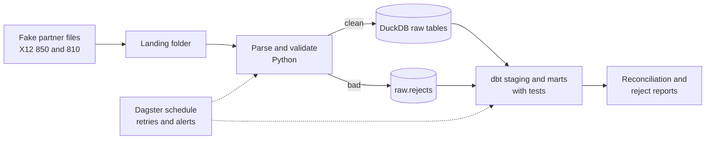

# EDI Pipeline

A portfolio project that simulates an EDI intake process end to end: fake trading partners drop synthetic X12 850 purchase orders and 810 invoices into a landing folder, Python parses and validates each file, clean documents load into DuckDB while bad ones are quarantined with an error code, dbt builds a tested star schema plus reconciliation and security models, and Dagster schedules the whole flow with retries and a reject-rate guard. Everything uses generated data, so the project can be cloned and run in minutes without credentials or cloud resources.

## Architecture



The security extension adds two checks on top of this flow: `UNKNOWN_SENDER` is a deterministic rule applied during parsing, and `fct_unusual_invoices` is a statistical z-score model in dbt.

## How to run

Use Python 3.11 or newer (3.12/3.13 tested).

```bash
# 1. Clone and enter the project
git clone https://github.com/YOUR-USERNAME/edi-pipeline.git
cd edi-pipeline

# 2. Create and activate a virtual environment
python -m venv .venv
source .venv/bin/activate          # Windows PowerShell: .venv\Scripts\Activate.ps1

# 3. Install dependencies and the local package
pip install -r requirements.txt
pip install -e .

# 4. Run the unit tests
python -m pytest -q                 # 5 passed

# 5. Generate a day of files and load them into DuckDB without Dagster
python -m edi_pipeline.run_local

# 6. Start Dagster, then open http://localhost:3000 and materialize all assets
dagster dev -f orchestration/definitions.py
```

Docker alternative — one command does the build, install, and webserver startup:

```bash
docker compose up --build
```

Then open http://localhost:3000 and click **Materialize all**. The `data/` folder is bind-mounted so generated files and the DuckDB database survive container restarts.

To reproduce the security measurements:

```bash
python -m edi_pipeline.security_eval
```

## Design decisions

- **Bad files are quarantined, not dropped.** Every rejection stays in `raw.rejects` with its file name, partner, error code, and detail, so a reviewer can see exactly which partner sent what and why. Dropping files would hide systemic problems and make the reject-rate gate meaningless.
- **The loader is idempotent.** Before inserting a day's files it deletes any rows for those file names from `raw.documents`, `raw.document_lines`, and `raw.rejects`, then reinserts them. Re-running a failed Dagster step or loading the same day twice therefore leaves one copy of each row, and control-number checks still catch duplicates across files and days.
- **The orphan-invoice test warns instead of failing.** An invoice can legitimately arrive for a purchase order that was rejected, arrived late, or came from a different system. A hard failure would block otherwise good data, so the relationship test is configured with `severity: warn` to keep the exception visible without stopping the build.
- **DuckDB for local use.** It runs in-process with no server, configuration, or credentials, stores the warehouse in a single file, and speaks SQL that transfers to a cloud warehouse later. That makes the project free and fast for a reviewer to reproduce.

## Data quality

Each invalid file can produce more than one row in `raw.rejects`; the loader records every error found.

| Error code | Meaning |
| --- | --- |
| `NOT_X12` | File does not start with a complete ISA segment. |
| `MISSING_ST` | No ST transaction-set header. |
| `MISSING_SE` | No SE transaction-set trailer. |
| `BAD_SE_COUNT` | SE segment count does not match the segments between ST and SE. |
| `SE_CONTROL_MISMATCH` | Control number in SE differs from ST. |
| `IEA_CONTROL_MISMATCH` | IEA control number is missing or differs from ISA13. |
| `UNSUPPORTED_TYPE` | Transaction set is neither 850 nor 810. |
| `MISSING_HEADER` | Missing BEG (850) or BIG (810) header. |
| `BAD_DATE` | Document date is not a valid `YYYYMMDD`. |
| `BAD_LINE_COUNT` | CTT line count differs from the parsed line items. |
| `BAD_TOTAL` | Invoice TDS total differs from the sum of line amounts. |
| `MISSING_TDS` | Invoice has no TDS total segment. |
| `DUPLICATE_CONTROL` | The partner/control-number pair was already used in another file. |
| `UNKNOWN_SENDER` | ISA06 sender ID is not in the known-partner list. |

## Results

From a clean local run of the current code (80 generated files, seeded run date 2026-11-20):

| Metric | Value |
| --- | ---: |
| Files generated | 80 |
| Files loaded into `raw.documents` | 69 |
| Files rejected into `raw.rejects` | 11 |
| Reject rate | 13.75% |

The reject rate is below the Dagster guard of 30%, so the `raw_tables` asset succeeds. `dbt build` completes with 24 passed nodes, 1 warning (orphan invoices), and 0 errors. The reconciliation mart reports 30 matched PO/invoice pairs, 7 purchase orders without invoices, and 2 invoices without purchase orders.

### Security extension

`UNKNOWN_SENDER` rejects any ISA06 sender outside the known-partner list; `fct_unusual_invoices` flags invoice totals more than two standard deviations from the partner's mean. The measurement script generates a seeded 600-file batch, loads it into an isolated warehouse, and compares findings with the generator manifest:

| Check | Injected | Caught | Clean items flagged by mistake |
| --- | ---: | ---: | ---: |
| `UNKNOWN_SENDER` (spoofed ISA06 sender) | 12 files | 12 | 0 files |
| `fct_unusual_invoices` (z-score > 2) | 4 invoices | 3 | 6 invoices |

### Limits

The z-score model is a screen, not a fraud detector:

- It has no business context. A large but legitimate invoice (approved price change, new contract, rush order) is indistinguishable from an inflated one, which is why six clean invoices were flagged in this run.
- It misses small, gradual overbilling that stays inside a partner's normal spread, and it looks only at invoice totals, not unit prices, quantities, dates, or duplicate invoices across partners.
- It cannot catch a spoofed sender that uses an ID already on the known-partner list, or a compromised legitimate partner. The `UNKNOWN_SENDER` rule only checks the ID in ISA06, not certificates, signatures, or IP origin.
- It cannot detect fabricated invoices that are individually ordinary and reconcile to a purchase order.
- With few invoices for a partner, `stddev_samp` is unstable or NULL; the model skips partners with zero variance, so a lone outlier there is missed.
- The threshold of 2 standard deviations is a convention applied to synthetic data. It is not calibrated against labelled real-world fraud, so both the miss rate and the false-positive rate would need to be re-measured on production data.

## What I would change at larger scale

- Store incoming files in object storage such as S3 and announce arrivals with a queue, instead of a shared landing folder.
- Replace full dbt rebuilds with incremental models and snapshots so only new documents are processed.
- Partition large fact tables by date and cluster them by partner to keep scans cheap.
- Run Dagster as a deployed service with a persistent instance, a real scheduler, and alerting on run failures and reject-rate breaches.
- Move to a cloud warehouse with role-based access and a secrets manager for credentials rather than local files.

## Limitations

- All data is synthetic: partner names, SKUs, prices, and documents are generated and contain no real company information.
- X12 handling is deliberately simplified: only 850 and 810 transaction sets are supported, with a fixed element separator and a small subset of segments. Real EDI varies by version, partner, and delimiter, and would need a proper parser or EDI engine.
- The z-score detector and the known-partner list are demonstrations, not a production security control; see **Limits** above.
- The warehouse is a local DuckDB file, so concurrent writers and multi-user access are out of scope.
